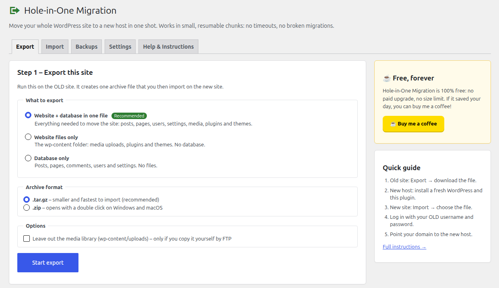

  

  

  
  
  
  
  

---

**Moving a WordPress site to a new host shouldn't fail at 87% with a "504 Gateway Timeout".**
Hole-in-One Migration packs your whole site (database, media, plugins and themes) into **one standard `.tar.gz` or `.zip` file** and unpacks it on the new host. It works in small chunks that finish long before any server limit, so cheap shared hosting with a 30-second time limit and a 2 MB upload limit is no problem.

No account, no cloud service, no paid "unlimited" upgrade. Your data goes straight from your old host to your new one.

  

## Why it doesn't time out

Most migration plugins try to do everything in one long request, and hosts kill long requests. This plugin does the opposite:

- ⏱️ **Short steps.** Each request works for a few seconds (never more than half the PHP time limit), saves a checkpoint and stops.
- 🔁 **Crash-proof.** If a request dies anyway (timeout, error 500/502/503/504, lost connection), the browser retries from the last checkpoint with smaller chunks, then speeds up again once the server is happy. Nothing is lost, nothing is done twice.
- 📦 **No upload limit.** The archive is uploaded in small pieces, and an interrupted upload resumes where it stopped. Huge sites can be uploaded by FTP instead.
- 🟢 **The new site stays online.** The database is imported next to the live one and switched in with one atomic step at the very end. If anything goes wrong before that, the site is unchanged.

## Features

|  |  |
|---|---|
| **One file** | Website + database in a single archive by default. Or export the files only, or the database only. |
| **Standard formats** | `.tar.gz` (smaller, recommended) or `.zip`. Both open with any archive tool, so your backup is never locked in. |
| **Smart search & replace** | Old addresses and server paths are replaced everywhere, including serialized data (widgets, page builders, theme options), JSON and URL-encoded data. |
| **Different table prefix?** | Handled automatically, including user roles and capabilities. |
| **MySQL ↔ MariaDB** | Collations, storage engines, foreign keys, zero dates and generated columns are converted automatically. |
| **Close the tab?** | Open the Migration page again and click **Resume**. |
| **No dependencies** | Pure PHP. No `exec()`, no `mysqldump`, no `tar` binary, no external libraries. Works where hosts disable all of that. |

## How to migrate a site

1. **Old site:** install the plugin, go to **Migration → Export**, click **Start export**, then **Download**.
2. **New host:** install a fresh, empty WordPress and this plugin. Nothing else.
3. **New site:** go to **Migration → Import**, choose the file and click **Upload and import**.
   For very large files, upload the archive by FTP into `wp-content/hio-migration/import/` and click **Import this file**.
4. **Log in with the username and password of the OLD site.** The users came over with the database.
5. Point your domain's DNS to the new host, set up SSL, and delete the backup files on both sites.

The plugin's **Help & Instructions** tab has the full guide and troubleshooting.

## Installation

Download [`hole-in-one-migration.zip`](https://github.com/wiks-sq/holeinone-migration/releases/latest/download/hole-in-one-migration.zip), then in WordPress go to **Plugins → Add New → Upload Plugin**, choose the zip and activate it. You'll find it under **Migration** in the admin menu.

Or copy the [`hole-in-one-migration/`](hole-in-one-migration) folder into `wp-content/plugins/`.

## Tested the hard way

Tested on PHP 8.5 with deliberately bad limits: a **5-second** time limit, **64 MB** memory and a **2 MB** upload limit, from MySQL 8 to MariaDB, with a different domain and table prefix. During the tests the PHP processes were **force-killed** again and again mid-migration.

- 🗄️ **4.3 GB database** (1M posts, 4M postmeta rows, 2M term relationships): exported and imported while PHP was force-killed 13 times. Every table identical afterwards, apart from the intended address change.
- 📁 **5.2 GB of files**, including a single 4.3 GB file: uploaded in 2,783 chunks and imported while PHP was force-killed 12 times. Every file checksum identical.
- 🧪 No PHP warnings or deprecation notices with `WP_DEBUG` on.

These tests ran in Docker, not on real hosting providers. Reports from real hosts are very welcome: please [open an issue](https://github.com/wiks-sq/holeinone-migration/issues).

## FAQ

**What's included?**
The `wp-content` folder (uploads, plugins, themes, languages) and all database tables with your WordPress table prefix. WordPress core and `wp-config.php` aren't included: the new host has its own, with its own database login.

**Where are backups stored? Are they safe?**
In `wp-content/hio-migration/backups/` under long random names that can't be guessed. Working files sit in a folder that denies web access. On **nginx** servers that protection doesn't apply, so delete backups right after downloading them. Uninstalling the plugin deletes all its backups.

**Is Multisite supported?**
No, single sites only.

**Can I open the archive myself?**
Yes. Inside are `wp-content/`, `hio-database.sql` and `hio-manifest.json`.

## For developers

How the chunking, resume logic, archive writers and atomic database swap work, plus the full test notes: [`docs/ARCHITECTURE.md`](docs/ARCHITECTURE.md).

## Support

Hole-in-One Migration is free, with no paid version and no size limit. If it saved your day, you can [buy me a coffee ☕](https://buymeacoffee.com/wikssq).

Found a bug or tested it on a host? Please [open an issue](https://github.com/wiks-sq/holeinone-migration/issues).

## License

[GPLv2 or later](LICENSE), like WordPress itself. Free forever.
